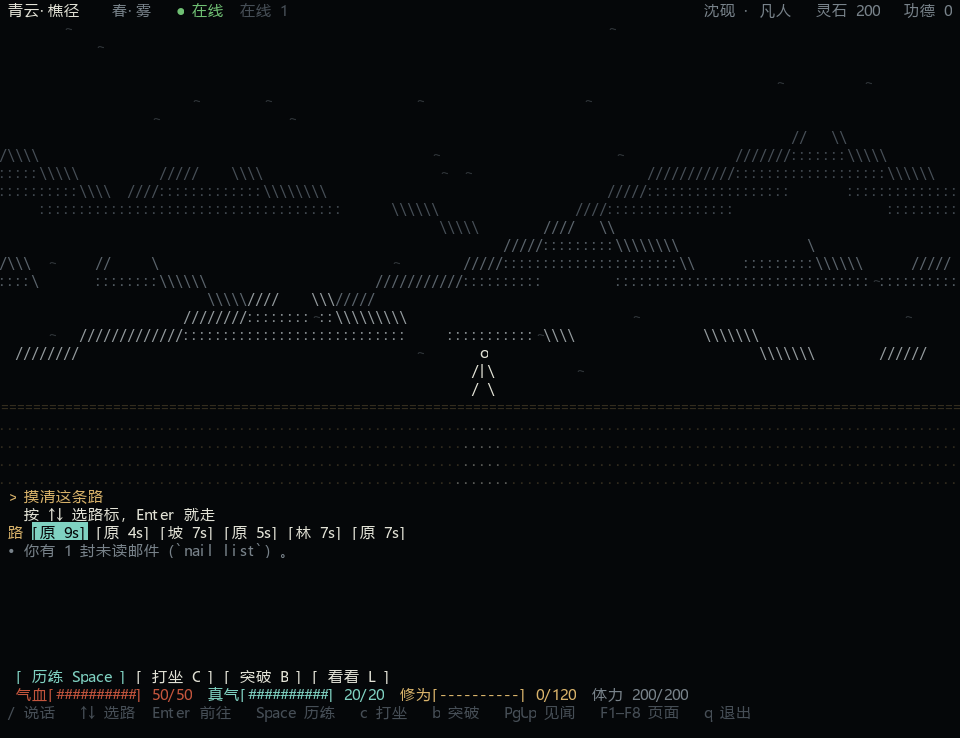

# 客户端工程

这是《九州问道》的客户端，**独立仓库**：`git@github.com:NJHHBJSJKAsjdsasa/xiuxian-mud-client.git`。
服务端在另一个仓库（`xiuxian-mud`），两边只通过协议对齐。

## 形态

**Rust 写的终端程序（ratatui / crossterm），不是网页。**
单二进制、无渲染后端、无资源目录：`cargo run` 直接在终端里铺满，SSH 上去也能玩。

理由见 `docs/01-SCOPE.md` §2：这个游戏的玩法是读文字、看格子地图、敲指令，
字符界面能把它表达清楚，而且没有"半吊子写实"的观感问题。

> 同仓另有 Go 实现 `go/`：纯 Go + 手写 ANSI，不引 TUI 框架，给联调与"临时看一眼"用。
> 两套走同一套 `/api/*` + `/ws`，界面口径同 `docs/05-UI.md`；构建与按键见 `go/README.md`。

## 现状

**M1 已落地**（2026-11-22）：登录 / 建号 / 字符场景 / 见闻 / 路标移动（含赶路倒计时）/
打坐 / 突破 / 探索 / 舆图，全部在终端里跑通。



- `src/` 分层：`protocol` / `net` / `store` / `view` / `app` / `tui`。
- `cargo clippy --all-targets -- -D warnings` 干净，`cargo test` 18 项全绿。
- 协议以服务端 `docs/05-PROTOCOL.md` 为准，接入流程看 `docs/12-API.md`。

## 怎么跑

```bash
# 服务端（另一个仓库）
cd ../xianxia && go run ./cmd/server

# 客户端（需要 80×24 以上终端）
cargo run -- --server ws://127.0.0.1:8080

# 跳过登录页；还没有角色时自动建号
cargo run -- --server ws://127.0.0.1:8080 --login 沈砚:test123456 --create 沈砚

# 直接看舆图
cargo run -- --server ws://127.0.0.1:8080 --login 沈砚:test123456 --page map

# 离屏出一屏（不占终端），再用脚本转 PNG
cargo run -- --login 沈砚:test123456 --snapshot shot.ansi
python tools/ansi2png.py shot.ansi shot.png
```

## 键位

| 键 | 动作 |
|---|---|
| `↑` `↓` | 选路标 |
| `Enter` | 前往 |
| `Space` | 历练 |
| `c` | 打坐 / 收功 |
| `b` | 突破 |
| `l` | 看看四周 |
| `/` | 说话（`Enter` 送出，`Tab` 换频道，`Esc` 取消） |
| `F1`–`F8` | 角色 / 背包 / 技能 / 江湖 / 坊市 / 宗门 / 舆图 / 设置 |
| `Esc` | 返回 |
| `q` | 退出 |

## 先读哪几份

| 顺序 | 文档 | 作用 |
|---|---|---|
| 1 | [`docs/00-INDEX.md`](docs/00-INDEX.md) | 文档目录与边界 |
| 2 | [`docs/01-SCOPE.md`](docs/01-SCOPE.md) | 做什么、不做什么 |
| 3 | [`docs/02-ARCH.md`](docs/02-ARCH.md) | crate 选型、分层、线程模型、目录结构 |
| 4 | [`docs/03-CONNECTION.md`](docs/03-CONNECTION.md) | 登录、握手、重连 |
| 5 | [`docs/05-UI.md`](docs/05-UI.md) | 终端布局、字符场景、按键、配色 |
| 6 | [`docs/09-ROADMAP.md`](docs/09-ROADMAP.md) | 里程碑与完成定义 |

## 技术栈

- Rust（edition 2024）+ tokio
- 界面：`ratatui` 0.29 + `crossterm` 0.28
- 传输：`tokio-tungstenite` + `rustls`；登录用 `reqwest`（rustls）
- 序列化：`serde` / `serde_json`
- 测试：`cargo test` + ratatui `TestBackend` 快照 + 服务端脚本对照
