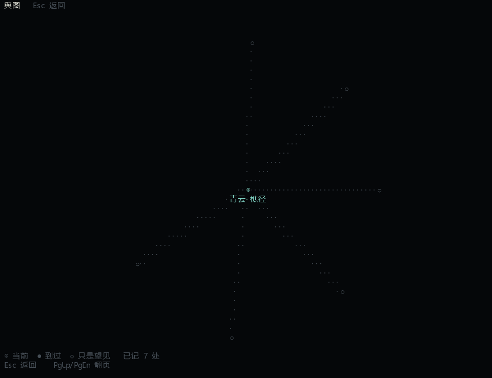

# 客户端 · 05 界面与信息架构（TUI）

```
doc_id: C-05
version: 4.0.0
updated: 2026-11-22
owns: 终端形态、屏幕布局、字符场景、按键、页面结构、配色与字形
depends_on: C-02、C-04、服务端 05（动作与推送）
```

## 1. 形态

**这是一个终端程序。** 单二进制、无渲染后端：`cargo run` 直接在终端里铺满，SSH 上去也能玩。

| 项 | 值 |
|---|---|
| 技术 | Rust + `ratatui` 0.29 + `crossterm` 0.28 |
| 最小终端 | 80×24（场景 8 行 + 路标 1 行 + 见闻 4 行） |
| 推荐终端 | 120×40 以上 |
| 字符集 | UTF-8；需要等宽 CJK（Windows Terminal / iTerm2 / 任意 `xterm-256color`） |
| 颜色 | 24 位真彩优先；不支持时退到 256 色 |

## 2. 屏幕布局

```
青云·樵径 青云郡   春·雨  ● 在线   在线 1                        沈砚 · 凡人   灵石 180

        /\        /\      /\              /\        /\        /\
       /  \  /\  /  \    /  \     /\     /  \  /\  /  \      /  \        雨：| | | | |
      /    \/  \/    \  /    \   /  \   /    \/  \/    \    /    \
     ::::::::::::::::::::::::::::::::::::::::::::::::::::::::::::::
                    |            o
                    |           /|\           ← 人（站 / 坐 / 走）
                                 / \
 ================================================================ 地面 ==============
 ...................................................................................

 > 摸清这条路
   按 ↑↓ 选路标，Enter 就走
 路 [←中州·落凡台 10s] [↙青云·浅滩 4s] [↘青云·碎石坡 7s] [↓青云观 5s] [→黑风林缘 7s] …
 • 你有一封未读邮件（mail list）
 • [世界] 【旁白】坊市·掌柜：布告栏上每天换三条，跑得动就接。
 [ 历练 Space ] [ 打坐 C ] [ 突破 B ] [ 看看 L ]
   气血[##########] 50/50  真气[##########] 20/20  修为[#########-] 90/120  体力 200/200
 / 说话   ↑↓ 选路  Enter 前往   Space 历练   c 打坐   b 突破   PgUp 见闻   F1–F8 页面   q 退出
```

纵向七段（`Layout::vertical`）：

| 段 | 高度 | 内容 |
|---|---|---|
| 顶栏 | 1 | 地名 · 区域 · 季节天气 · 连接灯 · 在线数；右侧道号/境界/灵石/功德 |
| 场景 | `Min(5)` | ASCII 字符画，占满剩余高度 |
| 目标 | 2 | `> 当前该做什么` + 一句具体指引 |
| 路标 | 1 | `[←地名 10s]` 一排，选中项反色；雾里看不见地名时用地形单字顶替（`[坡 7s]`） |
| 见闻 | 7 | 最近 7 条，`•` 前缀按类型着色 |
| 行动 | 2 | 四个方括号按钮 + 三条字符血条 + 体力 |
| 提示 | 1 | 未输入时是按键表；输入时变成 `世界> 内容▌` |

## 3. 字符场景（`tui/scene.rs`）

不加载任何资源，纯函数生成 `width × height` 的字符网格：

| 层 | 画法 |
|---|---|
| 天空 | 按昼夜给极暗底色（黎明偏暖、夜偏蓝），逐行插值 |
| 远/中/近山 | 每列算高度，只画脊线：上升 `/`、下降 `\`、持平 `_`；脊下补两行 `:` 做厚度 |
| 地形 | 水 `~`、林 `^` 与 `|`、镇 `_` `|`；其余留空 |
| 地面 | 一行 `=` + 下面全 `.` |
| 小路 | 从人影脚下向底边张开，用 `·` 填充 |
| 人影 | 三行字符：站 `o /|\ / \`、坐 `o /|\ ===`、走 `o /|\  |\` |
| 天气 | 雨 `|`、雪 `*`、沙尘与雾 `~`；只落在上半部分，不盖地面 |

约束：

- 随机位置用 `sin` 哈希，同一终端尺寸下每次都一样，不逐帧抖动。
- 只用 ASCII（`/ \ _ : . = ~ ^ | * o`），保证任何终端等宽对齐。
- 终端小于 8×4 时直接返回，不 panic。

## 4. 三个信息优先级

1. **我在哪**：顶栏地名 + 场景的地形与天气。
2. **该干什么**：目标卡两行；赶路时显示"前往 X · 剩 00:07"。
3. **往哪走**：路标一行，带 8 向箭头（由服务端 `x`/`y` 算出）与耗时；选中项整块反色。

## 5. 数据页

整屏覆盖，`Esc` 返回，底部固定提示行。

| 页 | 键 | 内容 |
|---|---|---|
| 角色 | `F1` | 境界/灵根/攻防/身法会心/战力/根骨/名分/功德轮回/丹毒 |
| 背包 | `F2` | 名称/数量/类别/售价，定宽列 |
| 技能 | `F3` | 主修与功法数 + 技能书（真气/威力/装配态） |
| 江湖 | `F4` | M3 占位 |
| 坊市 | `F5` | M3 占位 |
| 宗门 | `F6` | 玩家宗门 + NPC 势力 |
| 舆图 | `F7` | 已探索拓扑：`◎` 当前、`●` 到过、`○` 望见、`·` 通路、`x` 断路 |
| 设置 | `F8` | 服务器/协议/日志行数/配置文件路径 |

舆图把世界坐标压到字符网格（宽高比 1:2，纵向再乘 0.5），沿线段采样画点；
节点名写在点下方，超宽截断到 6 字。没名字的节点（雾里望见的）不写标签，
符号本身已经说明那里有路；当前节点名优先盖在连线之上，保证读得清。



## 6. 按键

| 键 | 动作 |
|---|---|
| `↑` `↓` / `k` `j` | 选路标 |
| `Enter` | 前往选中路标 |
| `Space` | 历练 |
| `c` | 打坐 / 收功 |
| `b` | 突破 |
| `l` | 看看四周（look） |
| `/` | 进入说话模式（`Enter` 送出、`Tab` 换频道、`Esc` 取消） |
| `PgUp` `PgDn` | 翻见闻 |
| `Home` `End` | 跳到最早 / 回到最新 |
| `F1`–`F8` | 数据页 |
| `Esc` | 从数据页返回 |
| `o` | 退出登录 |
| `q` | 退出客户端 |
| `Ctrl+C` | 强制退出 |

登录页：`Tab` 与 `↑↓` 切换输入框，`Ctrl+R` 切登录/注册，`Enter` 提交。

## 7. 配色与字形

| 用途 | 颜色 |
|---|---|
| 底 | `#050709` |
| 面板/提示条 | `#0A0D10` |
| 正文 | `#E2E2D6` |
| 弱化 | `#78828A`、`#464E56` |
| 玉青（交互/真气） | `#7FD1C1` |
| 金（收益/修为/地名） | `#D9B36A` |
| 朱砂（损失/气血/错误） | `#C4553D` |
| 草绿（回复/成功） | `#6FBF73` |

- 日志按类型着色：系统灰、旁白米黄、战斗白、收获绿、损失红、突破金、聊天青、PVP 紫。
- 进度条只用 `#` 与 `-`，不依赖任何绘图能力。

## 8. 不做

- 不做鼠标交互与动画（雨雪不飘，状态变化靠字符与颜色）；字形与列宽交给终端。
- 不做分屏与多标签：终端里一屏一世界，切页靠 `F1–F8`。
- 不做 256 色以下的降级：真彩与 256 色之外的终端不保证观感。
